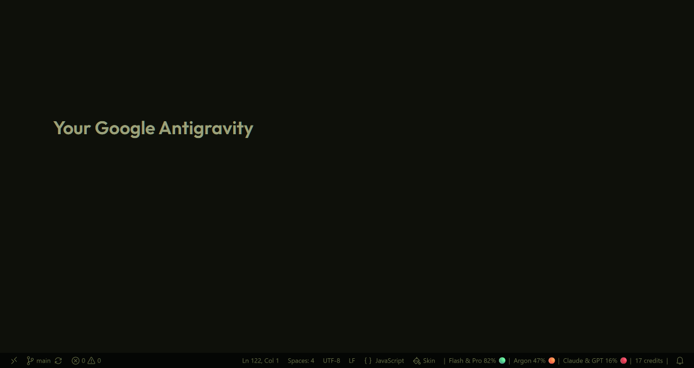
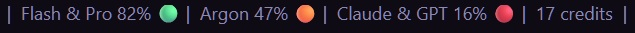

# Antigravity ARN-Lifebar: Minimalist extension to view your AI usage in the Status Bar

  

 
 

---

  <h2>
    💬 <a href="#en">🇬🇧 English</a> | 
    <a href="#fr">🇫🇷 Français</a> | 
    <a href="#cn">🇨🇳 中文</a> | 
    <a href="#es">🇪🇸 Español</a> | 
    <a href="#ar">🇸🇦 العربية</a> | 
    <a href="#th">🇹🇭 ภาษาไทย</a>
  </h2>

---

 

   
  
  <h2>🇬🇧 English</h2>
  <h3>Your Google Antigravity AI quotas in your IDE's status bar.</h3>
  

  ARN-Lifebar uses Antigravity IDE's built-in quota reader, or the Google Antigravity extension in other IDEs. It then displays your quotas in the status bar:
  

  <h3>🟢 > 50% · 🟠 50–25% · 🔴 24–1% · ⚫ 0%</h3>
  

---

### ⛔ What we left out

Why install a heavy dashboard just to read a percentage?

**ARN-Lifebar** gets straight to the point, **with no bloatware or telemetry:** 

* **Zero Webviews:** Everything is displayed natively in your `Status Bar`.
* **Zero dependencies:** 100% native JavaScript with no build step, making the code fully readable and auditable.
* **No internet connection:** ARN-Lifebar doesn't send anything anywhere. It reads your quotas from the Google Antigravity extension on your machine (`127.0.0.1`).

### ✨ The essentials, nothing more

* **Instant readout:** Your AI quotas at a glance with color coding and a refresh every 5 seconds.
* **Detailed tooltip:** Hover over the bar to see the included models and the **remaining time before your quotas reset**.
* **Cross-platform:** Compatible with Windows, macOS, and Linux.
* **Documentation in 6 languages, minimalist code:** We translated this README for the community; the extension itself contains no heavy translation framework.

---

## ❓ FAQ & Troubleshooting

**What should I do if the status bar shows `waiting for Antigravity`?**

ARN-Lifebar reads Google AI Plus/Pro/Ultra quotas from **Antigravity IDE**, or from the **Google Antigravity extension** in other IDEs. This message remains visible until Antigravity starts in the window; ARN-Lifebar retries at least once a minute.

-> *Are you using Antigravity IDE, or the Google Antigravity extension in your IDE? And are you signed in to your Google account?*

If so, it's a bug: please open an issue [here](https://github.com/jzbakh/antigravity-arn-lifebar/issues/new/choose).

**I'm using Antigravity IDE 2.5 or older.**

Since version 1.3, ARN-Lifebar reads quotas from Antigravity IDE 2.6 and later. Update the IDE, or install version 1.2.3 of ARN-Lifebar.

---

## 🚀 Installation

In Antigravity IDE, ARN-Lifebar works on its own. In other editors, such as VS Code, you also need to install the Google Antigravity extension.

<b>🔌 Via your editor's interface (Recommended)</b>

 

1. Open the **Extensions** view (`Ctrl+Shift+X`).
2. Search for `ARN-Lifebar`.
> 💡 **Tip:** Sort search results by **Name** (and NOT by popularity, relevance, or install count) to find it easily.
3. Click **Install** and enable the extension.

<b>💻 Installation via VSIX</b>

 

1. Download the [`antigravity-arn-lifebar.vsix`](https://github.com/jzbakh/antigravity-arn-lifebar/releases/latest/download/antigravity-arn-lifebar.vsix) file.
2. In your editor, open the **Extensions** view (`Ctrl+Shift+X`).
3. Click the "..." menu (Views and More Actions) at the top of the sidebar.
4. Select **Install from VSIX...**
5. Choose the downloaded file and restart the editor.

<b>🔧 Manual Installation</b>

 

1. Create a folder named `ARN-Lifebar`, then download and place the 3 files `package.json`, `extension.js`, and `README.md` inside it.
2. Copy this folder into your editor's extensions directory:
   - **Antigravity IDE**: `%USERPROFILE%\.antigravity-ide\extensions\` (Windows) or `~/.antigravity-ide/extensions/` (macOS/Linux)
   - **VS Code**: `%USERPROFILE%\.vscode\extensions\` (Windows) or `~/.vscode/extensions/` (macOS/Linux)
3. Restart the editor and enable the extension.

---

## 🩵 Support the Project

 

  <b>💫 Do you like this project? Leave a ⭐ on GitHub or GitLab to support it!</b>

  
  

  A review on <a href="https://open-vsx.org/extension/jzbakh/antigravity-arn-lifebar/reviews">Open VSX</a> or the <a href="https://marketplace.visualstudio.com/items?itemName=jzbakh.antigravity-arn-lifebar&ssr=false#review-details">VS Marketplace</a> also helps others find it.

 

    

---

### ☕ Financial Support

If you'd like to financially support the development and future updates, you can buy me a coffee or make a cryptocurrency donation. Thank you so much! 🫶

**Cryptocurrency donations:**

<b>₿ Bitcoin (BTC)</b>

 

`bc1q4zu08uxpfra9aecp28x6zelg23qdcdeg680hlg`

<b>Ethereum (ETH) & ERC-20 Tokens</b>

 

`0xdc593BfaD6Be146400B713c2787DCCb9392AC206`

<b>Solana (SOL)</b>

 

`FwBu1oqSCdfDvvFhy3crYBkgzjDuwDcU5gxXzVCqxTn9`

---

  <b>Made with 🩵 by <a href="https://gitlab.com/arn_inside">jzbakh</a></b>

---

 

   
  
  <h2>🇫🇷 Français</h2>
  <h3>Vos quotas IA Google Antigravity dans la barre d'état de votre IDE.</h3>
  

  ARN-Lifebar utilise le lecteur de quotas natif d'Antigravity IDE, ou l'extension Google Antigravity dans les autres IDE. Il affiche ensuite vos quotas dans la barre d'état :
  

  <h3>🟢 > 50 % · 🟠 50-25 % · 🔴 24-1 % · ⚫ 0 %</h3>
  

---

### ⛔ Ce que nous n'avons pas

Pourquoi installer un tableau de bord lourd juste pour lire un pourcentage ?

**ARN-Lifebar** va à l'essentiel, **sans bloatware ni télémétrie :** 

* **Zéro Webview :** Tout s'affiche nativement dans votre barre d'état (`Status Bar`).
* **Zéro dépendance :** 100 % JavaScript natif, sans étape de build. Le code est lisible et auditable.
* **Aucune connexion internet :** ARN-Lifebar n'envoie rien nulle part. Il lit vos quotas auprès de l'extension Google Antigravity, sur votre machine (`127.0.0.1`).

### ✨ L'essentiel, rien de plus

* **Lecture instantanée :** Vos quotas d'IA en un coup d'œil grâce au code couleur et à un rafraîchissement toutes les 5 secondes.
* **Info-bulle détaillée :** Survolez la barre pour voir les modèles inclus et le **temps restant avant la réinitialisation** de vos quotas.
* **Multiplateforme :** Compatible Windows, macOS et Linux.
* **Documentation en 6 langues, code minimaliste :** Nous avons traduit ce README pour la communauté ; l'extension elle-même ne contient aucun framework de traduction lourd.

---

## ❓ FAQ & Dépannage

**La barre d'état affiche `waiting for Antigravity`, que faire ?**

ARN-Lifebar lit les quotas Google AI Plus/Pro/Ultra d'**Antigravity IDE**, ou de l'**extension Google Antigravity** dans les autres IDE. Ce message reste affiché tant qu'Antigravity n'a pas démarré dans la fenêtre ; ARN-Lifebar réessaie au moins une fois par minute.

-> *Utilisez-vous Antigravity IDE, ou l'extension Google Antigravity dans votre IDE ? Et êtes-vous connecté(e) à votre compte Google ?*

Si oui, alors il s'agit d'un bug : merci d'ouvrir une issue [ici](https://github.com/jzbakh/antigravity-arn-lifebar/issues/new/choose).

**J'utilise Antigravity IDE 2.5 ou une version plus ancienne.**

Depuis sa version 1.3, ARN-Lifebar lit les quotas d'Antigravity IDE 2.6 et des versions suivantes. Mettez l'IDE à jour, ou installez la version 1.2.3 d'ARN-Lifebar.

---

## 🚀 Installation

Dans Antigravity IDE, ARN-Lifebar fonctionne seul. Dans un autre éditeur, comme VS Code, installez aussi l'extension Google Antigravity.

<b>🔌 Via l'interface de votre éditeur (recommandé)</b>

 

1. Ouvrez la vue **Extensions** (`Ctrl+Shift+X`).
2. Recherchez `ARN-Lifebar`.
> 💡 **Astuce :** Triez les résultats de recherche par **Nom** (et PAS par popularité, pertinence ou nombre d'installations) pour trouver l'extension facilement.
3. Cliquez sur **Installer** et activez l'extension.

<b>💻 Installation via VSIX</b>

 

1. Téléchargez le fichier [`antigravity-arn-lifebar.vsix`](https://github.com/jzbakh/antigravity-arn-lifebar/releases/latest/download/antigravity-arn-lifebar.vsix).
2. Dans votre éditeur, ouvrez la vue **Extensions** (`Ctrl+Shift+X`).
3. Cliquez sur le menu « ... » (Vues et autres actions) en haut de la barre latérale.
4. Sélectionnez **Installer à partir de VSIX...**
5. Choisissez le fichier téléchargé et redémarrez l'éditeur.

<b>🔧 Installation manuelle</b>

 

1. Créez un dossier nommé `ARN-Lifebar`, puis téléchargez et placez-y les 3 fichiers `package.json`, `extension.js` et `README.md`.
2. Copiez ce dossier dans le répertoire des extensions de votre éditeur :
   - **Antigravity IDE** : `%USERPROFILE%\.antigravity-ide\extensions\` (Windows) ou `~/.antigravity-ide/extensions/` (macOS/Linux)
   - **VS Code** : `%USERPROFILE%\.vscode\extensions\` (Windows) ou `~/.vscode/extensions/` (macOS/Linux)
3. Relancez l'éditeur et activez l'extension.

---

## 🩵 Soutenir le projet

 

  <b>💫 Ce projet vous plaît ? Laissez une ⭐ sur GitHub ou GitLab pour le soutenir !</b>

  
  

  Un avis sur <a href="https://open-vsx.org/extension/jzbakh/antigravity-arn-lifebar/reviews">Open VSX</a> ou le <a href="https://marketplace.visualstudio.com/items?itemName=jzbakh.antigravity-arn-lifebar&ssr=false#review-details">VS Marketplace</a> aide aussi d'autres personnes à le découvrir.

 

    

---

### ☕ Soutien financier

Si vous souhaitez contribuer financièrement au développement et aux futures mises à jour, vous pouvez m'offrir un café ou faire un don en cryptomonnaies. Merci infiniment ! 🫶

**Dons en cryptomonnaies :**

<b>₿ Bitcoin (BTC)</b>

 

`bc1q4zu08uxpfra9aecp28x6zelg23qdcdeg680hlg`

<b>Ethereum (ETH) et tokens ERC-20</b>

 

`0xdc593BfaD6Be146400B713c2787DCCb9392AC206`

<b>Solana (SOL)</b>

 

`FwBu1oqSCdfDvvFhy3crYBkgzjDuwDcU5gxXzVCqxTn9`

---

  <b>Créé avec 🩵 par <a href="https://gitlab.com/arn_inside">jzbakh</a></b>

---

 

   
  
  <h2>🇨🇳 中文</h2>
  <h3>在 IDE 状态栏中查看您的 Google Antigravity AI 配额。</h3>
  

  ARN-Lifebar 使用 Antigravity IDE 原生的配额读取器，或在其他 IDE 中使用 Google Antigravity 扩展，然后将配额显示在状态栏中：
  

  <h3>🟢 > 50% · 🟠 50～25% · 🔴 24～1% · ⚫ 0%</h3>
  

---

### ⛔ 我们剔除的冗余

为什么只为了看一个百分比，就要安装一个笨重的仪表盘？

**ARN-Lifebar** 直击本质，**无冗余软件（Bloatware）或遥测：**

* **零 Webview：** 一切都在您的状态栏（`Status Bar`）中原生显示。
* **零依赖：** 100% 原生 JavaScript，无需构建步骤，代码清晰易读且易于审计。
* **无需联网：** ARN-Lifebar 不会向任何地方发送任何数据。它仅从您本机的 Google Antigravity 扩展读取配额（`127.0.0.1`）。

### ✨ 核心必备，毫无多余

* **即时查看：** 通过颜色编码与每 5 秒自动刷新，让您的 AI 配额一目了然。
* **详细悬停提示：** 将鼠标悬停在状态栏上，即可查看包含的模型以及**配额重置前的剩余时间**。
* **跨平台：** 兼容 Windows、macOS 和 Linux。
* **6 种语言文档，极简代码：** 我们为社区翻译了此 README；扩展程序本身不包含任何笨重的翻译框架。

---

## ❓ 常见问题与故障排除

**状态栏显示 `waiting for Antigravity`，该怎么办？**

ARN-Lifebar 读取 **Antigravity IDE** 中的 Google AI Plus/Pro/Ultra 配额，在其他 IDE 中则通过 **Google Antigravity 扩展**读取。此消息会一直显示，直到 Antigravity 在该窗口中启动；ARN-Lifebar 至少每分钟重试一次。

-> *您使用的是 Antigravity IDE，还是在您的 IDE 中使用 Google Antigravity 扩展？您是否已登录 Google 账号？*

如果是，那么这是一个 bug：请[在此处](https://github.com/jzbakh/antigravity-arn-lifebar/issues/new/choose)提交 issue。

**我使用的是 Antigravity IDE 2.5 或更早版本。**

自 1.3 版起，ARN-Lifebar 读取 Antigravity IDE 2.6 及更高版本的配额。请更新 IDE，或安装 ARN-Lifebar 1.2.3 版。

---

## 🚀 安装

在 Antigravity IDE 中，ARN-Lifebar 可独立运行。在其他编辑器（例如 VS Code）中，还需安装 Google Antigravity 扩展。

<b>🔌 通过编辑器界面安装（推荐）</b>

 

1. 打开**扩展**视图（`Ctrl+Shift+X`）。
2. 搜索 `ARN-Lifebar`。
> 💡 **提示：** 将搜索结果按**名称**排序（而**不是**按热门程度、相关性或安装计数），即可轻松找到该扩展。
3. 点击**安装**并启用扩展程序。

<b>💻 通过 VSIX 安装</b>

 

1. 下载 [`antigravity-arn-lifebar.vsix`](https://github.com/jzbakh/antigravity-arn-lifebar/releases/latest/download/antigravity-arn-lifebar.vsix) 文件。
2. 在您的编辑器中，打开**扩展**视图（`Ctrl+Shift+X`）。
3. 点击侧边栏顶部的“...”菜单（视图和更多操作）。
4. 选择 **从 VSIX 安装...**
5. 选择下载的文件并重启编辑器。

<b>🔧 手动安装</b>

 

1. 创建一个名为 `ARN-Lifebar` 的文件夹，然后下载并将 `package.json`、`extension.js` 和 `README.md` 这 3 个文件放入其中。
2. 将此文件夹复制到您的编辑器扩展目录中：
   - **Antigravity IDE**：`%USERPROFILE%\.antigravity-ide\extensions\`（Windows）或 `~/.antigravity-ide/extensions/`（macOS/Linux）
   - **VS Code**：`%USERPROFILE%\.vscode\extensions\`（Windows）或 `~/.vscode/extensions/`（macOS/Linux）
3. 重启编辑器并启用扩展程序。

---

## 🩵 支持项目

 

  <b>💫 喜欢这个项目吗？在 GitHub 或 GitLab 上点亮 ⭐ 来支持一下吧！</b>

  
  

  在 <a href="https://open-vsx.org/extension/jzbakh/antigravity-arn-lifebar/reviews">Open VSX</a> 或 <a href="https://marketplace.visualstudio.com/items?itemName=jzbakh.antigravity-arn-lifebar&ssr=false#review-details">VS Marketplace</a> 上留下评价，也能帮助更多人发现它。

 

    

---

### ☕ 资金支持

如果您愿意在资金上支持本项目的开发和未来的更新，可以请我喝杯咖啡或进行加密货币捐赠。非常感谢！🫶

**加密货币捐赠：**

<b>₿ 比特币（BTC）</b>

 

`bc1q4zu08uxpfra9aecp28x6zelg23qdcdeg680hlg`

<b>以太坊（ETH）与 ERC-20 代币</b>

 

`0xdc593BfaD6Be146400B713c2787DCCb9392AC206`

<b>索拉纳（SOL）</b>

 

`FwBu1oqSCdfDvvFhy3crYBkgzjDuwDcU5gxXzVCqxTn9`

---

  <b>由 <a href="https://gitlab.com/arn_inside">jzbakh</a> 用 🩵 制作</b>

---

 

   
  
  <h2>🇪🇸 Español</h2>
  <h3>Tus cuotas de IA de Google Antigravity en la barra de estado de tu IDE.</h3>
  

  ARN-Lifebar utiliza el lector de cuotas nativo de Antigravity IDE o la extensión Google Antigravity en los demás IDE. Luego las muestra en la barra de estado:
  

  <h3>🟢 > 50 % · 🟠 50-25 % · 🔴 24-1 % · ⚫ 0 %</h3>
  

---

### ⛔ Lo que no incluimos

¿Por qué instalar un panel de control pesado solo para leer un porcentaje?

**ARN-Lifebar** va a lo esencial, **sin bloatware ni telemetría:** 

* **Cero Webviews:** Todo se muestra nativamente en tu barra de estado (`Status Bar`).
* **Cero dependencias:** 100 % JavaScript nativo, sin paso de compilación. El código es legible y auditable.
* **Sin conexión a internet:** ARN-Lifebar no envía nada a ninguna parte. Lee tus cuotas de la extensión Google Antigravity en tu máquina (`127.0.0.1`).

### ✨ Lo esencial, nada más

* **Lectura instantánea:** Tus cuotas de IA de un vistazo gracias al código de colores y a una actualización cada 5 segundos.
* **Información detallada:** Pasa el cursor sobre la barra para ver los modelos incluidos y el **tiempo restante antes de que se reinicien** tus cuotas.
* **Multiplataforma:** Compatible con Windows, macOS y Linux.
* **Documentación en 6 idiomas, código minimalista:** Hemos traducido este README para la comunidad; la extensión en sí no contiene ningún framework de traducción pesado.

---

## ❓ Preguntas frecuentes y solución de problemas

**La barra de estado muestra `waiting for Antigravity`, ¿qué hacer?**

ARN-Lifebar lee las cuotas de Google AI Plus/Pro/Ultra de **Antigravity IDE** o de la **extensión Google Antigravity** en los demás IDE. Este mensaje permanece visible hasta que Antigravity se inicie en la ventana; ARN-Lifebar vuelve a intentarlo al menos una vez por minuto.

-> *¿Utilizas Antigravity IDE o la extensión Google Antigravity en tu IDE? ¿Y has iniciado sesión en tu cuenta de Google?*

Si es así, entonces se trata de un bug: por favor, abre un issue [aquí](https://github.com/jzbakh/antigravity-arn-lifebar/issues/new/choose).

**Uso Antigravity IDE 2.5 o una versión anterior.**

Desde la versión 1.3, ARN-Lifebar lee las cuotas de Antigravity IDE 2.6 y versiones posteriores. Actualiza el IDE o instala la versión 1.2.3 de ARN-Lifebar.

---

## 🚀 Instalación

En Antigravity IDE, ARN-Lifebar funciona por sí solo. En otro editor, como VS Code, instala también la extensión Google Antigravity.

<b>🔌 A través de la interfaz de tu editor (recomendado)</b>

 

1. Abre la vista de **Extensiones** (`Ctrl+Shift+X`).
2. Busca `ARN-Lifebar`.
> 💡 **Consejo:** Ordena los resultados de búsqueda por **Nombre** (y NO por popularidad, relevancia o número de instalaciones) para encontrar la extensión fácilmente.
3. Haz clic en **Instalar** y activa la extensión.

<b>💻 Instalación a través de VSIX</b>

 

1. Descarga el archivo [`antigravity-arn-lifebar.vsix`](https://github.com/jzbakh/antigravity-arn-lifebar/releases/latest/download/antigravity-arn-lifebar.vsix).
2. En tu editor, abre la vista de **Extensiones** (`Ctrl+Shift+X`).
3. Haz clic en el menú "..." (Vistas y más acciones) en la parte superior de la barra lateral.
4. Selecciona **Instalar desde VSIX...**
5. Elige el archivo descargado y reinicia el editor.

<b>🔧 Instalación manual</b>

 

1. Crea una carpeta llamada `ARN-Lifebar`, luego descarga y coloca en ella los 3 archivos `package.json`, `extension.js` y `README.md`.
2. Copia esta carpeta en el directorio de extensiones de tu editor:
   - **Antigravity IDE**: `%USERPROFILE%\.antigravity-ide\extensions\` (Windows) o `~/.antigravity-ide/extensions/` (macOS/Linux)
   - **VS Code**: `%USERPROFILE%\.vscode\extensions\` (Windows) o `~/.vscode/extensions/` (macOS/Linux)
3. Reinicia el editor y activa la extensión.

---

## 🩵 Apoyar el proyecto

 

  <b>💫 ¿Te gusta este proyecto? ¡Deja una ⭐ en GitHub o GitLab para apoyarlo!</b>

  
  

  Una reseña en <a href="https://open-vsx.org/extension/jzbakh/antigravity-arn-lifebar/reviews">Open VSX</a> o en el <a href="https://marketplace.visualstudio.com/items?itemName=jzbakh.antigravity-arn-lifebar&ssr=false#review-details">VS Marketplace</a> también ayuda a que otros lo descubran.

 

    

---

### ☕ Apoyo financiero

Si deseas contribuir económicamente al desarrollo y a futuras actualizaciones, puedes invitarme a un café o hacer una donación en criptomonedas. ¡Muchas gracias! 🫶

**Donaciones en criptomonedas:**

<b>₿ Bitcoin (BTC)</b>

 

`bc1q4zu08uxpfra9aecp28x6zelg23qdcdeg680hlg`

<b>Ethereum (ETH) y tokens ERC-20</b>

 

`0xdc593BfaD6Be146400B713c2787DCCb9392AC206`

<b>Solana (SOL)</b>

 

`FwBu1oqSCdfDvvFhy3crYBkgzjDuwDcU5gxXzVCqxTn9`

---

  <b>Hecho con 🩵 por <a href="https://gitlab.com/arn_inside">jzbakh</a></b>

---

 

   
  
  <h2>🇸🇦 العربية</h2>
  <h3>حصص الذكاء الاصطناعي من Google Antigravity في شريط الحالة لبيئة تطويرك.</h3>
  

  تستخدم ARN-Lifebar قارئ الحصص المدمج في Antigravity IDE أو إضافة Google Antigravity في بيئات التطوير الأخرى، ثم تعرضها في شريط الحالة:
  

  <h3>🟢 > 50% · 🟠 50–25% · 🔴 24–1% · ⚫ 0%</h3>
  

---

### ⛔ ما استغنينا عنه

لماذا تثبّت لوحة تحكم ثقيلة لمجرد قراءة نسبة مئوية؟

تركز **ARN-Lifebar** على الأهم، **بدون برامج زائدة (bloatware) أو قياس عن بعد (telemetry):**

* **بدون واجهة ويب (Webview):** يُعرض كل شيء بشكل أصلي في شريط الحالة (`Status Bar`).
* **بدون تبعيات:** JavaScript أصلي 100%، بدون خطوة بناء (build step). الكود قابل للقراءة والتدقيق.
* **بدون اتصال بالإنترنت:** لا ترسل ARN-Lifebar أي بيانات إلى أي مكان، بل تقرأ حصصك محليًا من إضافة Google Antigravity على جهازك (`127.0.0.1`).

### ✨ الأساسيات، لا أكثر

* **قراءة فورية:** حصصك من الذكاء الاصطناعي في لمحة بفضل الترميز اللوني وتحديث كل 5 ثوانٍ.
* **تلميح تفصيلي:** مرر مؤشر الماوس فوق الشريط لرؤية النماذج المضمنة و**الوقت المتبقي قبل تجديد** حصصك.
* **متعدد المنصات:** متوافق مع Windows و macOS و Linux.
* **توثيق بـ 6 لغات، كود بسيط:** قمنا بترجمة ملف README هذا من أجل المجتمع؛ الإضافة نفسها لا تحتوي على أي إطار عمل (framework) ترجمة ثقيل.

---

## ❓ الأسئلة الشائعة واستكشاف الأخطاء وإصلاحها

**يعرض شريط الحالة `waiting for Antigravity`، ماذا أفعل؟**

تقرأ ARN-Lifebar حصص Google AI Plus/Pro/Ultra من **Antigravity IDE** أو من **إضافة Google Antigravity** في بيئات التطوير الأخرى. تبقى هذه الرسالة ظاهرة حتى يبدأ تشغيل Antigravity في النافذة؛ وتعيد ARN-Lifebar المحاولة مرة واحدة على الأقل كل دقيقة.

← *هل تستخدم Antigravity IDE أو إضافة Google Antigravity في بيئة تطويرك؟ وهل سجّلت الدخول إلى حسابك في Google؟*

إذا كان الأمر كذلك، فهذا يعني وجود خلل (bug): يُرجى فتح مشكلة (issue) [هنا](https://github.com/jzbakh/antigravity-arn-lifebar/issues/new/choose).

**أستخدم Antigravity IDE 2.5 أو إصدارًا أقدم.**

منذ الإصدار 1.3، تقرأ ARN-Lifebar حصص Antigravity IDE 2.6 والإصدارات الأحدث. قم بتحديث بيئة التطوير أو ثبّت الإصدار 1.2.3 من ARN-Lifebar.

---

## 🚀 التثبيت

في Antigravity IDE، تعمل ARN-Lifebar بمفردها. في محرر آخر مثل VS Code، ثبّت أيضًا إضافة Google Antigravity.

<b>🔌 عبر واجهة محررك (موصى به)</b>

 

1. افتح عرض **الإضافات** (Extensions) بالضغط على `Ctrl+Shift+X`.
2. ابحث عن `ARN-Lifebar`.
> 💡 **نصيحة:** رتّب نتائج البحث حسب **الاسم** (Name)، وليس حسب الشعبية أو مدى الصلة أو عدد مرات التثبيت، للعثور على الإضافة بسهولة.
3. انقر على **تثبيت** (Install) وقم بتفعيل الإضافة.

<b>💻 التثبيت عبر VSIX</b>

 

1. قم بتنزيل ملف [`antigravity-arn-lifebar.vsix`](https://github.com/jzbakh/antigravity-arn-lifebar/releases/latest/download/antigravity-arn-lifebar.vsix).
2. في محررك، افتح عرض **الإضافات** (Extensions) بالضغط على `Ctrl+Shift+X`.
3. انقر على قائمة «...» (Views and More Actions) أعلى الشريط الجانبي.
4. حدد **Install from VSIX...** (تثبيت من VSIX).
5. اختر الملف الذي تم تنزيله وأعد تشغيل المحرر.

<b>🔧 التثبيت اليدوي</b>

 

1. أنشئ مجلدًا باسم `ARN-Lifebar`، ثم قم بتنزيل ووضع الملفات الثلاثة `package.json` و `extension.js` و `README.md` بداخله.
2. انسخ هذا المجلد إلى مجلد إضافات محررك:
   - في **Antigravity IDE:** `%USERPROFILE%\.antigravity-ide\extensions\` (Windows) أو `~/.antigravity-ide/extensions/` (macOS/Linux)
   - في **VS Code:** `%USERPROFILE%\.vscode\extensions\` (Windows) أو `~/.vscode/extensions/` (macOS/Linux)
3. أعد تشغيل المحرر وقم بتفعيل الإضافة.

---

## 🩵 دعم المشروع

 

  <b>💫 هل أعجبك هذا المشروع؟ اترك ⭐ على GitHub أو GitLab لدعمه!</b>

  
  

  تقييمك على <a href="https://open-vsx.org/extension/jzbakh/antigravity-arn-lifebar/reviews">Open VSX</a> أو <a href="https://marketplace.visualstudio.com/items?itemName=jzbakh.antigravity-arn-lifebar&ssr=false#review-details">VS Marketplace</a> يساعد الآخرين أيضًا على اكتشافه.

 

    

---

### ☕ الدعم المالي

إذا كنت ترغب في المساهمة ماليًا في التطوير والتحديثات المستقبلية، يمكنك أن تشتري لي قهوة أو تتبرع بالعملات المشفرة. شكرًا جزيلاً لك! 🫶

**التبرعات بالعملات المشفرة:**

<b>₿ بيتكوين (BTC)</b>

 

`bc1q4zu08uxpfra9aecp28x6zelg23qdcdeg680hlg`

<b>إيثريوم (ETH) ورموز ERC-20</b>

 

`0xdc593BfaD6Be146400B713c2787DCCb9392AC206`

<b>سولانا (SOL)</b>

 

`FwBu1oqSCdfDvvFhy3crYBkgzjDuwDcU5gxXzVCqxTn9`

---

  <b>صُنع بـ 🩵 بواسطة <a href="https://gitlab.com/arn_inside">jzbakh</a></b>

---

 

   
  
  <h2>🇹🇭 ภาษาไทย</h2>
  <h3>โควตา AI ของ Google Antigravity ในแถบสถานะของ IDE ของคุณ</h3>
  

  ARN-Lifebar ใช้ตัวอ่านโควตาที่มีมาในตัวของ Antigravity IDE หรือส่วนขยาย Google Antigravity ใน IDE อื่น ๆ จากนั้นจึงแสดงผลในแถบสถานะ:
  

  <h3>🟢 > 50% · 🟠 50-25% · 🔴 24-1% · ⚫ 0%</h3>
  

---

### ⛔ สิ่งที่เราตัดออกไป

ทำไมต้องติดตั้งแดชบอร์ดที่หนักหน่วงเพียงเพื่ออ่านค่าเปอร์เซ็นต์?

**ARN-Lifebar** มุ่งเน้นไปที่สิ่งสำคัญ **ปราศจากซอฟต์แวร์ขยะ (bloatware) และการเก็บข้อมูลทางไกล (telemetry):** 

* **ไม่มี Webview:** ทุกอย่างแสดงผลแบบเนทีฟในแถบสถานะ (`Status Bar`) ของคุณ
* **ไม่มี Dependency:** JavaScript เนทีฟ 100% โดยไม่มีขั้นตอนการบิลด์ (build step) โค้ดอ่านง่ายและตรวจสอบได้
* **ไม่ต้องเชื่อมต่ออินเทอร์เน็ต:** ARN-Lifebar ไม่ส่งข้อมูลใด ๆ ออกไปที่ไหนเลย โดยจะอ่านโควตาจากส่วนขยาย Google Antigravity บนเครื่องของคุณ (`127.0.0.1`)

### ✨ สิ่งสำคัญเท่านั้น ไม่มีส่วนเกิน

* **อ่านค่าได้ทันที:** ดูโควตา AI ของคุณได้ในพริบตา ด้วยรหัสสีและการรีเฟรชทุก 5 วินาที
* **แสดงรายละเอียดเมื่อชี้เมาส์:** วางเมาส์เหนือแถบสถานะเพื่อดูโมเดลที่รวมอยู่ และ**เวลาที่เหลือก่อนโควตาจะรีเซ็ต**
* **รองรับหลายแพลตฟอร์ม:** ใช้งานได้บน Windows, macOS และ Linux
* **เอกสารประกอบ 6 ภาษา โค้ดมินิมอล:** เราแปลไฟล์ README นี้เพื่อชุมชน แต่ตัวส่วนขยายเองไม่มีเฟรมเวิร์กแปลภาษาที่หนักหน่วง

---

## ❓ คำถามที่พบบ่อยและการแก้ไขปัญหา

**หากแถบสถานะแสดง `waiting for Antigravity` ควรทำอย่างไร?**

ARN-Lifebar อ่านโควตา Google AI Plus/Pro/Ultra จาก **Antigravity IDE** หรือจาก **ส่วนขยาย Google Antigravity** ใน IDE อื่น ๆ ข้อความนี้จะแสดงอยู่จนกว่า Antigravity จะเริ่มทำงานในหน้าต่างนั้น และ ARN-Lifebar จะลองใหม่อย่างน้อยนาทีละครั้ง

-> *คุณกำลังใช้ Antigravity IDE หรือส่วนขยาย Google Antigravity ใน IDE ของคุณอยู่หรือไม่? และได้ลงชื่อเข้าใช้บัญชี Google แล้วหรือยัง?*

หากใช่ แสดงว่าเป็นข้อผิดพลาด (bug): โปรดแจ้งปัญหา (issue) [ที่นี่](https://github.com/jzbakh/antigravity-arn-lifebar/issues/new/choose)

**กรณีใช้ Antigravity IDE 2.5 หรือต่ำกว่า**

ตั้งแต่เวอร์ชัน 1.3 เป็นต้นไป ARN-Lifebar จะอ่านโควตาของ Antigravity IDE 2.6 และเวอร์ชันที่ใหม่กว่า โปรดอัปเดต IDE หรือติดตั้ง ARN-Lifebar เวอร์ชัน 1.2.3

---

## 🚀 การติดตั้ง

ใน Antigravity IDE นั้น ARN-Lifebar ทำงานได้ด้วยตัวเอง ส่วนในโปรแกรมแก้ไขอื่น เช่น VS Code ให้ติดตั้งส่วนขยาย Google Antigravity ด้วย

<b>🔌 ผ่านอินเทอร์เฟซของโปรแกรมแก้ไข (แนะนำ)</b>

 

1. เปิดมุมมอง **ส่วนขยาย (Extensions)** โดยกด `Ctrl+Shift+X`
2. ค้นหา `ARN-Lifebar`
> 💡 **เคล็ดลับ:** จัดเรียงผลการค้นหาตาม **ชื่อ (Name)** (ไม่ใช่ตามความนิยม ความเกี่ยวข้อง หรือจำนวนการติดตั้ง) เพื่อหาส่วนขยายได้ง่ายขึ้น
3. คลิก **ติดตั้ง (Install)** และเปิดใช้งานส่วนขยาย

<b>💻 การติดตั้งผ่าน VSIX</b>

 

1. ดาวน์โหลดไฟล์ [`antigravity-arn-lifebar.vsix`](https://github.com/jzbakh/antigravity-arn-lifebar/releases/latest/download/antigravity-arn-lifebar.vsix)
2. ในโปรแกรมแก้ไขของคุณ ให้เปิดมุมมอง **ส่วนขยาย (Extensions)** โดยกด `Ctrl+Shift+X`
3. คลิกที่เมนู "..." (Views and More Actions) ที่ด้านบนสุดของแถบด้านข้าง
4. เลือก **ติดตั้งจาก VSIX... (Install from VSIX...)**
5. เลือกไฟล์ที่ดาวน์โหลดมาแล้วรีสตาร์ตโปรแกรมแก้ไข

<b>🔧 การติดตั้งด้วยตนเอง</b>

 

1. สร้างโฟลเดอร์ชื่อ `ARN-Lifebar` จากนั้นดาวน์โหลดและวางไฟล์ 3 ไฟล์ ได้แก่ `package.json`, `extension.js` และ `README.md` ไว้ข้างใน
2. คัดลอกโฟลเดอร์นี้ไปยังไดเรกทอรีส่วนขยายของโปรแกรมแก้ไข:
   - **Antigravity IDE:** `%USERPROFILE%\.antigravity-ide\extensions\` (Windows) หรือ `~/.antigravity-ide/extensions/` (macOS/Linux)
   - **VS Code:** `%USERPROFILE%\.vscode\extensions\` (Windows) หรือ `~/.vscode/extensions/` (macOS/Linux)
3. รีสตาร์ตโปรแกรมแก้ไขและเปิดใช้งานส่วนขยาย

---

## 🩵 สนับสนุนโปรเจกต์

 

  <b>💫 ชอบโปรเจกต์นี้ไหม? กด ⭐ บน GitHub หรือ GitLab เพื่อสนับสนุนกันได้เลย!</b>

  
  

  การรีวิวบน <a href="https://open-vsx.org/extension/jzbakh/antigravity-arn-lifebar/reviews">Open VSX</a> หรือ <a href="https://marketplace.visualstudio.com/items?itemName=jzbakh.antigravity-arn-lifebar&ssr=false#review-details">VS Marketplace</a> ก็ช่วยให้ผู้อื่นค้นพบโปรเจกต์นี้ได้เช่นกัน

 

    

---

### ☕ การสนับสนุนทางการเงิน

หากคุณต้องการสนับสนุนทางการเงินสำหรับการพัฒนาและการอัปเดตในอนาคต ก็สามารถเลี้ยงกาแฟสักแก้วหรือบริจาคเป็นสกุลเงินดิจิทัลได้ ขอบคุณมาก! 🫶

**การบริจาคสกุลเงินดิจิทัล:**

<b>₿ บิตคอยน์ (BTC)</b>

 

`bc1q4zu08uxpfra9aecp28x6zelg23qdcdeg680hlg`

<b>อีเธอเรียม (ETH) และโทเคน ERC-20</b>

 

`0xdc593BfaD6Be146400B713c2787DCCb9392AC206`

<b>โซลานา (SOL)</b>

 

`FwBu1oqSCdfDvvFhy3crYBkgzjDuwDcU5gxXzVCqxTn9`

---

  <b>สร้างด้วย 🩵 โดย <a href="https://gitlab.com/arn_inside">jzbakh</a></b>

